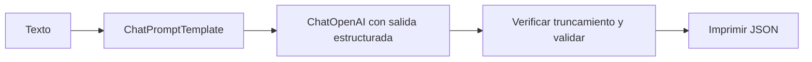

# Pipeline de extracción técnica

Pre-entrega 2 de AI Engineering. Un pipeline asíncrono recibe un texto técnico y devuelve una extracción validada con Pydantic.

**Tipo** · Pipeline de procesamiento de texto  
**Stack** · Python 3.14, LangChain, Pydantic 2 y OpenAI

## Descripción

La demostración analiza un párrafo sobre una API en FastAPI con demoras en Redis. El resultado contiene las tecnologías mencionadas, la criticidad y un resumen técnico.

## Arquitectura

| Archivo | Responsabilidad |
|---|---|
| `schemas.py` | Define el modelo Pydantic `TechnicalExtraction` y la criticidad `baja`, `media` o `alta`. |
| `chain.py` | Compone el prompt, la salida estructurada y la validación con LCEL. Ejecuta la cadena con `.ainvoke()`. |
| `main.py` | Hace una demostración asíncrona, habilita los logs e imprime el resultado en JSON. |

`ChatPromptTemplate` separa las instrucciones del texto. `with_structured_output()` usa el esquema Pydantic y conserva el mensaje original para inspeccionar `finish_reason`. Si la respuesta está truncada, falla el parseo o falta un objeto válido, `.with_retry()` vuelve a generar y validar. Con el mismo timeout de red hay hasta tres intentos de extracción, incluida la primera llamada.

La primera consulta usa un timeout de red de 30 segundos. Si vence, el pipeline vuelve a consultar con 45 segundos y, si vuelve a vencer, con 60 segundos. Los reintentos internos del SDK están desactivados. Los valores limitan esperas de red y la extracción completa puede durar más por los reintentos.

El código usa nombres en inglés. Los alias de Pydantic mantienen las claves del JSON de la consigna: `tecnologias`, `nivel_de_criticidad` y `resumen_tecnico`. La criticidad y el resumen se expresan en español.

## Diagrama de flujo



## Requisitos

- Python **3.14** y `pip`.
- Una clave de API de OpenAI y acceso al modelo configurado para ejecutar la demostración.

## Instalación

Desde la raíz del proyecto, en PowerShell, crea `.venv` si todavía no existe e instala las dependencias.

```powershell
py -3.14 -m venv .venv
.\.venv\Scripts\python.exe -m pip install -r requirements.txt
```

## Configuración

Si todavía no tienes un archivo de configuración local, crea la carpeta y copia [`.env.example`](.env.example).

```powershell
New-Item -ItemType Directory -Force config | Out-Null
if (-not (Test-Path -LiteralPath .\config\.env)) {
    Copy-Item .\.env.example .\config\.env
}
```

Completa estas variables en `config/.env`.

| Variable | Uso |
|---|---|
| `OPENAI_API_KEY` | Clave de API de OpenAI. |
| `OPENAI_MODEL` | Identificador del modelo, por ejemplo `gpt-4o-mini`. |

El pipeline usa las dos variables de OpenAI de la tabla. `config/.env` es local y está excluido de Git.

## Pruebas

El recorrido de la cadena, los reintentos y la impresión del JSON se verificaron localmente con respuestas simuladas. La demostración de consola usa la API real de OpenAI.

Para probar con un texto ambiguo, ejecuta desde la raíz del proyecto.

```powershell
.\.venv\Scripts\python.exe main.py --ambiguo
```

El caso menciona fallos intermitentes con impacto incierto y omite los nombres de los componentes. Comprueba que `tecnologias` sea `[]` y que el resumen conserve la incertidumbre. El modelo elige la criticidad según la evidencia del texto. Pydantic verifica que pertenezca al enum. Si la salida llega truncada o incumple el esquema, los logs permiten seguir los reintentos.

## Uso

Ejecuta desde la raíz del proyecto.

```powershell
.\.venv\Scripts\python.exe main.py
```

Ejemplo ilustrativo de la salida:

```json
{
  "tecnologias": ["FastAPI", "Redis"],
  "nivel_de_criticidad": "media",
  "resumen_tecnico": "La API en FastAPI sigue operativa, pero Redis presenta demoras que afectan algunas solicitudes."
}
```

Los logs muestran el resultado de la validación y el timeout del siguiente intento cuando vence el tiempo de espera de red. Si falla la configuración, se agotan los intentos o el SDK devuelve otro error, la demo registra el motivo y termina con código `1`.

## Estructura del proyecto

```text
.
├── .env.example
├── .gitignore
├── README.md
├── chain.py
├── main.py
├── requirements.txt
└── schemas.py
```

## Solución de problemas

| Síntoma | Acción |
|---|---|
| `ModuleNotFoundError` | Instala `requirements.txt` y ejecuta el script con el Python de `.venv`. |
| Falta `OPENAI_MODEL` o falla la autenticación | Revisa el modelo y la clave en `config/.env`. |
| `InvalidOutputError` | Revisa los avisos de truncamiento o validación en los logs. Se agotaron los intentos de extracción. |
